# İstek Servise Hiç Ulaşmadı: Kong Gateway ile .NET Mikroservislerine Tek Kapı Açmak

## 1. Giriş: Neden API Gateway?

Mikroservis mimarisine geçen ekiplerin büyük bölümü şu noktada tıkanır: servis sayısı arttı, peki dışarıya hangi kapıdan çıkıyorlar?

İlk refleks genelde her servisi kendi portundan dışarı açmak olur. Kısa vadede çalışır, ama her yeni servis şu listeyi baştan yazmanızı ister:

- **Kimlik doğrulama** her servise tek tek yazılır; biri unutur, o servis açıkta kalır.
- **Rate limiting** yoktur veya her serviste farklı şekilde vardır.
- **CORS** ayarları servis başına kopyalanır, biri eski kalır.
- **Hangi endpoint'in dışarı açık olduğu** kod içine gömülüdür; görmek için kodu okumak gerekir.
- Bir endpoint'i kapatmak **deploy** gerektirir.

API Gateway bu ortak işleri tek bir yere taşır. Client ile backend servislerinizin arasına girer, her istek ondan geçer; yönlendirme, kimlik doğrulama, kota, dönüştürme ve gözlemlenebilirlik kapıda hallolur. Backend servisiniz bunların hiçbirinden haberdar olmaz — ve asıl kazanç da budur.

Bu yazıda gateway olarak **Kong Gateway OSS**, arka taraftaki servisler için **.NET 9** kullanacağız. Hedefimiz tek bir cümleyi uçtan uca kanıtlamak:

> Dışarı açmadığımız bir endpoint'e gelen istek, .NET servisine **hiç ulaşmaz**.

"Ulaşmaz" lafta kalmasın diye bunu üç ayrı yerden gözlemleyeceğiz.

---

## 2. Kong 101 — Temel Kavramlar

Kong'da her şey dört kavramın üzerine kurulu:

| Kavram | Ne demek |
|---|---|
| **Service** | Arka taraftaki gerçek servis (upstream). Örnek: `http://products-api:8080` |
| **Route** | Gelen istek hangi kurala uyarsa o Service'e gider. Örnek: path `/api/products` |
| **Plugin** | İstek/yanıt üzerinde çalışan davranış. Global, Service, Route veya Consumer bazlı |
| **Consumer** | API'yi tüketen taraf (kullanıcı/uygulama). Anahtarlar ve kotalar buna bağlanır |
| **Upstream** | Birden fazla hedefi (target) olan, yük dengelenmiş havuz |

Akış şöyle işler:

```
Client -> [Route eşleşir] -> [Plugin'ler çalışır] -> Service -> Backend
```

Bu zincirin en kritik halkası ilk ok: **Route eşleşmezse zincir orada biter.** Plugin'ler çalışmaz, Service'e gidilmez, backend isteği hiç görmez. Yazının geri kalanı büyük ölçüde bu cümlenin sonuçlarıyla ilgili.

---

## 3. Ortamı Kurmak: Docker ile Kong Gateway OSS

Kong'u yerelde çalıştırmanın en pratik yolu Docker Compose. Kurulumumuz dört parçadan oluşuyor: Postgres (konfigürasyonun yaşadığı yer), bir kerelik migration container'ı, Kong'un kendisi ve test için bir sahte backend.

```yaml
services:
  kong-db:
    image: postgres:16-alpine
    environment:
      POSTGRES_USER: kong
      POSTGRES_PASSWORD: kongpass
      POSTGRES_DB: kong
    ports:
      # Host'ta zaten 5432'de başka bir PostgreSQL çalıştığı için 5433 veriyoruz.
      - "127.0.0.1:5433:5432"
    healthcheck:
      test: ["CMD-SHELL", "pg_isready -U kong"]
      interval: 5s

  # Kong'un şemasını DB'ye bir kez kurar, sonra çıkar
  kong-migrations:
    image: kong:3.9
    depends_on:
      kong-db: { condition: service_healthy }
    environment:
      KONG_DATABASE: postgres
      KONG_PG_HOST: kong-db
      KONG_PG_USER: kong
      KONG_PG_PASSWORD: kongpass
    command: kong migrations bootstrap

  kong:
    image: kong:3.9
    depends_on:
      kong-migrations: { condition: service_completed_successfully }
    environment:
      KONG_DATABASE: postgres
      KONG_PG_HOST: kong-db
      KONG_PG_USER: kong
      KONG_PG_PASSWORD: kongpass
      KONG_PROXY_ACCESS_LOG: /dev/stdout
      KONG_PROXY_ERROR_LOG: /dev/stderr
      KONG_ADMIN_LISTEN: 0.0.0.0:8001      # SADECE lokal deneme için!
      KONG_ADMIN_GUI_LISTEN: 0.0.0.0:8002
    ports:
      - "8000:8000"   # proxy
      - "8001:8001"   # admin api
      - "8002:8002"   # kong manager ui
```

`docker compose up -d` dedikten sonra elinizde şu adresler olur:

| Adres | Ne |
|---|---|
| http://localhost:8000 | **Proxy** — istekleri buraya atıyorsunuz |
| http://localhost:8001 | **Admin API** — konfigürasyon REST API'si |
| http://localhost:8002 | **Kong Manager** — web arayüz |
| http://localhost:8080 | **httpbin** — test backend'i (Kong'u bypass edip doğrudan görebilirsiniz) |

Dikkat edilecek nokta: `kong-migrations` container'ı `service_completed_successfully` koşuluyla bekleniyor. Yani Kong, şema kurulmadan ayağa kalkmaya çalışmıyor — ilk `up` komutunda yarış durumu yaşamamanızın sebebi bu.

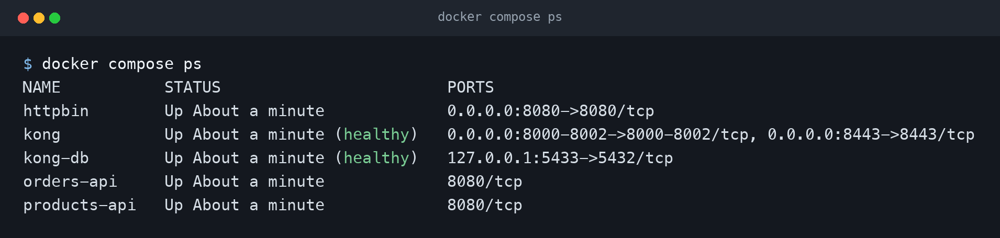

---

## 4. İlk Denemeler: Route, Rate Limiting ve Key Auth

Kavramları gerçek bir servisle boğuşmadan önce `httpbin` üzerinde deneyelim. Önce bir Service, sonra onun üzerine üç farklı Route:

```bash
# Service: arka taraftaki gerçek adres
curl -X POST localhost:8001/services \
  --data name=httpbin-service \
  --data url=http://httpbin:8080

# Route 1: düz proxy, plugin yok
curl -X POST localhost:8001/services/httpbin-service/routes \
  --data name=demo-route --data 'paths[]=/demo'
```

Artık `/demo` altına attığınız her şey httpbin'e gidiyor:

```bash
curl -s localhost:8000/demo/get | jq
```

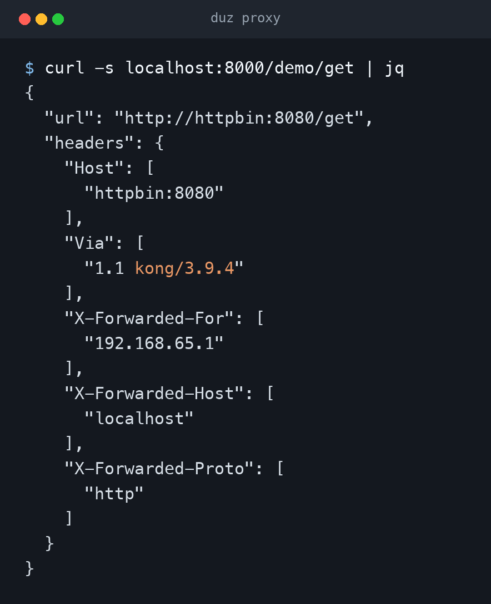

Yanıtın header'larına bakın — Kong kendini belli ediyor:

```bash
curl -i localhost:8000/demo/get
```

```
HTTP/1.1 200 OK
Via: kong/3.9.4
X-Kong-Upstream-Latency: 3
X-Kong-Proxy-Latency: 1
```

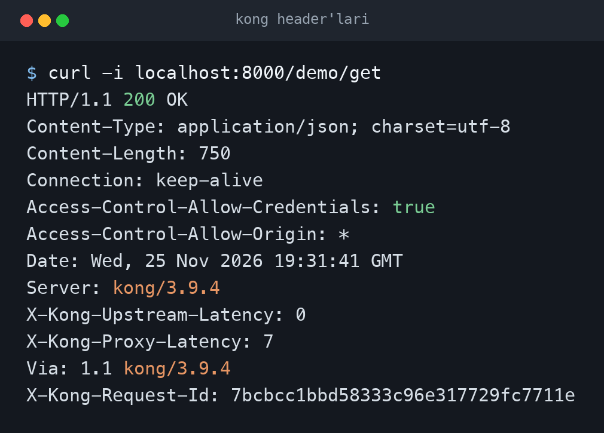

`X-Kong-Upstream-Latency` arkadaki servisin kaç ms'de cevap verdiğini, `X-Kong-Proxy-Latency` ise Kong'un kendi karar süresini söyler. Bu iki header yazının 7. bölümünde işimize yarayacak.

### Rate limiting

İkinci route'a dakikada 5 istek sınırı koyalım:

```bash
curl -X POST localhost:8001/services/httpbin-service/routes \
  --data name=limited-route --data 'paths[]=/limited'

curl -X POST localhost:8001/routes/limited-route/plugins \
  --data name=rate-limiting \
  --data config.minute=5 \
  --data config.policy=local
```

Sınırı patlatmak için yedi istek atın:

```bash
for i in $(seq 1 7); do
  curl -s -o /dev/null -w "%{http_code}\n" localhost:8000/limited/get
done
```

```
200
200
200
200
200
429
429
```

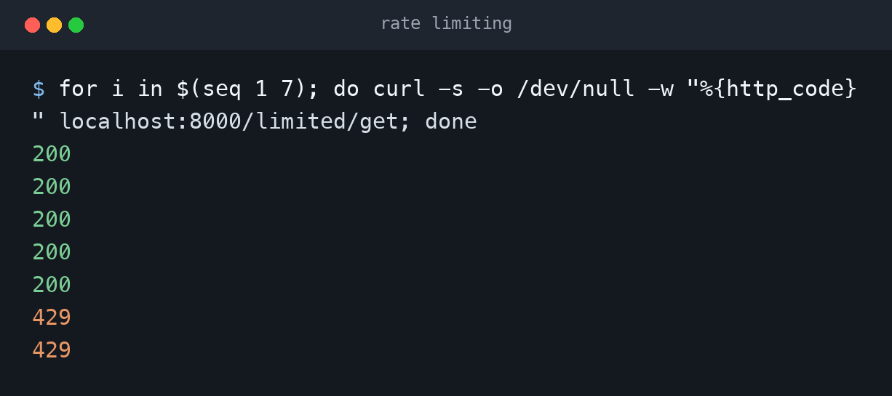

6. istekten itibaren `429 Too Many Requests`. Burada önemli olan şu: bu 429'ları **Kong üretti**, httpbin bu iki isteği hiç görmedi.

`config.policy=local` sayacı Kong node'unun kendi belleğinde tutar. Tek node'lu lokal kurulumda doğru seçim, ama birden fazla Kong node'u varsa her node kendi sayacını tutacağı için gerçek limit `node sayısı × 5` olur. Üretimde `cluster` veya `redis` politikası kullanılır.

### Key auth

Üçüncü route'u API anahtarıyla koruyalım:

```bash
curl -X POST localhost:8001/services/httpbin-service/routes \
  --data name=secure-route --data 'paths[]=/secure'

curl -X POST localhost:8001/routes/secure-route/plugins --data name=key-auth

# Anahtarın sahibi bir Consumer olmalı
curl -X POST localhost:8001/consumers --data username=emre
curl -X POST localhost:8001/consumers/emre/key-auth --data key=gizli-anahtar-123
```

Test:

```bash
curl -i localhost:8000/secure/get
# HTTP/1.1 401 Unauthorized
# {"message":"No API key found in request"}

curl -i -H 'apikey: gizli-anahtar-123' localhost:8000/secure/get
# HTTP/1.1 200 OK
```

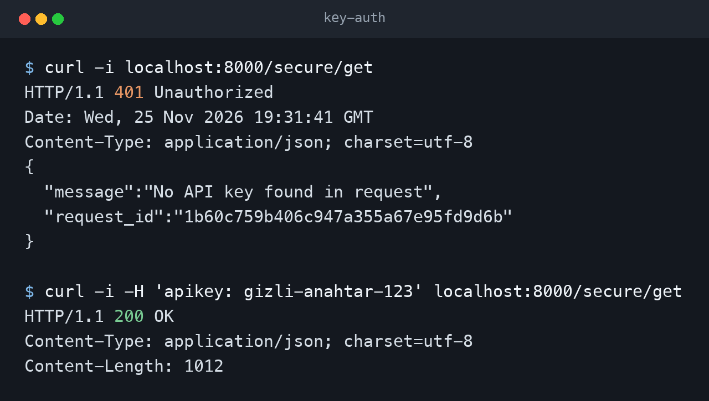

**Önemli nokta:** httpbin'in kodunda tek satır kimlik doğrulama yok. Anahtar kontrolü tamamen kapıda yapıldı ve backend sadece geçen isteği gördü. Gateway'in asıl değeri bu: güvenlik kodu, korumak istediğiniz servisin içinde yaşamıyor.

---

## 5. Gerçekçi Senaryo: Portu Olmayan İki .NET Servisi

httpbin eğlenceli ama gerçek hayatta elinizde kendi servisleriniz var. İki minimal API yazdım: `products-api` ve `orders-api`.

`products-api` dört endpoint içeriyor ve bunların yalnızca **biri** dışarı açılacak:

```csharp
var products = new List<Product>
{
    new(1, "Klavye",   1250.00m, 42),
    new(2, "Mouse",     680.50m, 17),
    new(3, "Monitor",  8900.00m,  5),
    new(4, "Kulaklik", 2300.00m,  0),
};

// --- 1) PUBLIC: ürün listesi. Kong üzerinden dışarıya açılan TEK endpoint bu. ---
app.MapGet("/products", () =>
    Results.Ok(products.Select(p => new { p.Id, p.Name, p.Price })));

// --- 2) INTERNAL: tek ürün detayı (stok bilgisi dahil) ---
app.MapGet("/products/{id:int}", (int id) => /* ... */);

// --- 3) INTERNAL: iş metrikleri. Dışarıya asla açılmamalı. ---
app.MapGet("/internal/stats", () => Results.Ok(new
{
    totalProducts  = products.Count,
    outOfStock     = products.Count(p => p.Stock == 0),
    inventoryValue = products.Sum(p => p.Price * p.Stock),
    secret = "bu-veri-disariya-cikmamali"
}));

app.MapGet("/health", () => Results.Ok(new { status = "healthy" }));
```

Endpoint'lerin niyeti:

| Endpoint | Durum |
|---|---|
| `GET /products` | **PUBLIC** — Kong üzerinden dışarıya açıldı |
| `GET /products/{id}` | internal (stok bilgisi içeriyor) |
| `GET /internal/stats` | internal (ciro/stok verisi, dışarıya çıkmamalı) |
| `GET /health` | internal |

`orders-api` ise sipariş oluştururken `products-api`'yi çağırıyor — ama dikkat edin, **gateway'e uğramadan**:

```csharp
// products-api'ye doğrudan (Kong'dan GEÇMEDEN) gidecek client.
// Servisler arası trafik iç ağ üzerinden, gateway'e uğramadan akar.
builder.Services.AddHttpClient("products", client =>
{
    var baseUrl = builder.Configuration["PRODUCTS_API_URL"] ?? "http://products-api:8080";
    client.BaseAddress = new Uri(baseUrl);
    client.Timeout = TimeSpan.FromSeconds(5);
});
```

Bu bilinçli bir tercih. Kong **kuzey-güney** trafiği (dışarıdan içeriye) için duruyor; servisler arası **doğu-batı** trafiğini gateway'den geçirmek gereksiz bir atlama (hop) ve gereksiz bir arıza noktası ekler. Servis-servis iletişimini yönetmek istiyorsanız o işin aracı service mesh'tir, API gateway değil.

### Kritik compose detayı

Her iki servisin compose tanımında **`ports:` yok**:

```yaml
  products-api:
    build: ./services/products-api
    expose:
      - "8080"        # sadece Docker iç ağında görünür

  orders-api:
    build: ./services/orders-api
    environment:
      PRODUCTS_API_URL: http://products-api:8080
    expose:
      - "8080"
```

`expose`, portu yalnızca Docker iç ağına açar; `ports` ise host'a yayınlar. Yani kendi makinenizden `localhost:8080/internal/stats` diye bu servise ulaşamazsınız — **dışarıya tek kapı Kong (8000)**. Gerçek hayatta mikroservisler de böyle durur: sadece iç ağda.

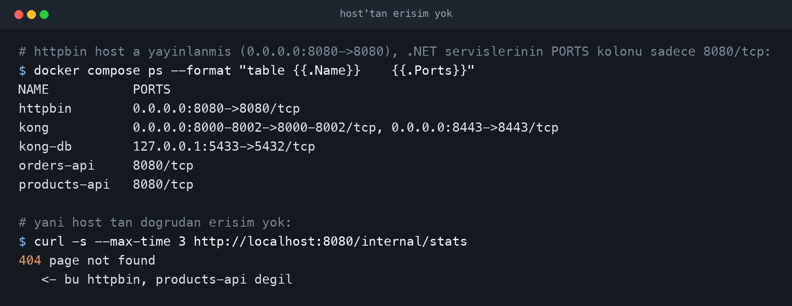

Servisleri iç ağdan görmek isterseniz aynı ağa geçici bir container atmanız gerekir:

```bash
docker run --rm --network kong-test_default curlimages/curl \
  -s http://products-api:8080/internal/stats
```

```json
{"totalProducts":4,"outOfStock":1,"inventoryValue":126860.00,"secret":"bu-veri-disariya-cikmamali"}
```

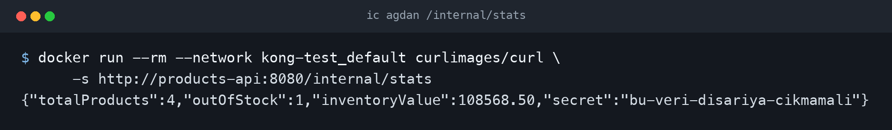

Veri orada, çalışıyor. Şimdi bunun dışarıya **çıkmadığını** garanti etmemiz gerekiyor.

---

## 6. Tek Endpoint'i Dışa Açmak: Regex, `$` ve `methods`

Konfigürasyon iki çağrıdan ibaret:

```bash
# Service: upstream adresi + path
curl -X POST localhost:8001/services \
  --data name=products-service \
  --data url=http://products-api:8080/products

# Route: SADECE GET, ve path TAM OLARAK /api/products
curl -X POST localhost:8001/services/products-service/routes \
  --data name=public-products \
  --data 'paths[]=~/api/products$' \
  --data 'methods[]=GET' \
  --data strip_path=true
```

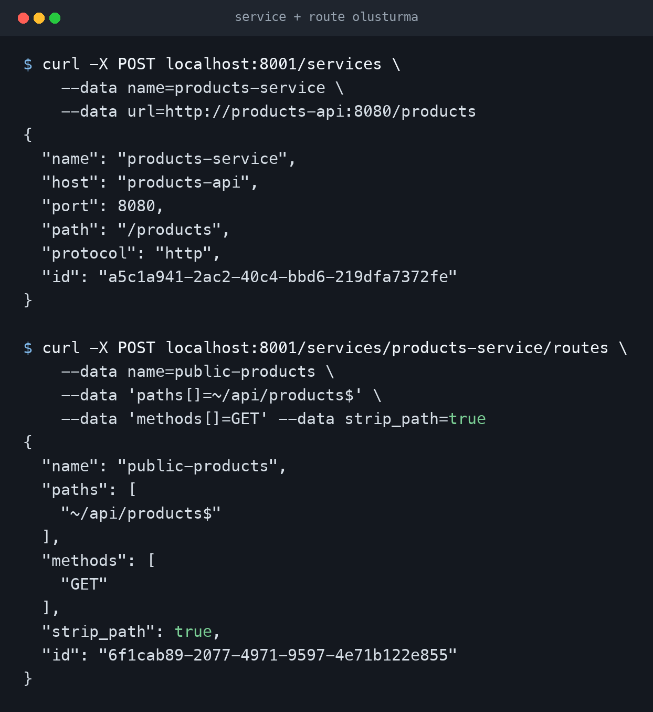

**Kritik detay:** `paths` değerinin başındaki `~` bunun bir regex olduğunu, sonundaki `$` ise tam eşleşme gerektiğini söyler.

Bunu yazmazsanız — yani `paths[]=/api/products` deseniz — Kong **prefix** eşleştirir. O zaman `/api/products/3`, `/api/products/internal/stats` gibi altındaki her şey de açılır. Tek bir endpoint açacaksanız `$` pazarlık konusu değil.

`methods[]=GET` aynı mantığın method tarafı: POST/PUT/DELETE istekleri bu route'a hiç eşleşmez, dolayısıyla hiçbir servise gitmez.

`strip_path=true` ise path'in eşleşen kısmını keser. Zinciri takip edelim: `/api/products` isteği gelir, eşleşen kısım kesilir (geriye boş string kalır), Service'in kendi `path`'i olan `/products` eklenir ve upstream'e `GET /products` gider. .NET tarafındaki endpoint `/products` olduğu için tam oturur. Yani dışarıdaki URL ile içerideki URL birbirinden tamamen bağımsız — bu da gateway'in hoş bir yan faydası.

### Doğrulanmış davranış

```
GET  /api/products        -> 200  (ürün listesi döner)
GET  /api/products/3      -> 404  (route yok, servise hiç gitmez)
GET  /api/internal/stats  -> 404
GET  /api/orders          -> 404
POST /api/products        -> 404  (method eşleşmedi)
```

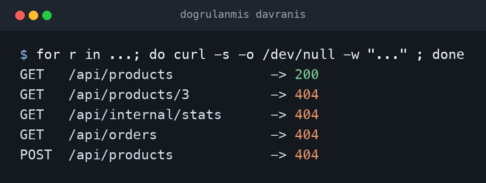

Bu 404'lerin önemi şu: istek .NET servisine **hiç ulaşmıyor**. Servis bu isteklerden haberdar bile değil, Kong kapıda çevirdi.

Ama "haberdar değil" iddialı bir cümle. Kanıtlayalım.

---

## 7. "Kong Kapıda Çevirdi"yi Kanıtlamak

Engellenen bir isteğin arkaya gitmediğini üç ayrı yerden gözlemleyebilirsiniz.

### Yöntem 1: Canlı karar akışı

Kong'un her istek için verdiği kararı JSON olarak yazdırması için global bir `file-log` plugin'i ekliyoruz:

```bash
curl -X POST localhost:8001/plugins \
  --data name=file-log \
  --data config.path=/dev/stdout \
  --data config.reopen=true
```

Bu plugin'in ham çıktısı epey kalabalık, ama işimize yarayan dört alan var:

| Alan | İzinli istek | Engellenen istek |
|---|---|---|
| `route` | `public-products` | `null` |
| `service` | `products-service` | `null` |
| `upstream_uri` | `/products` | `""` |
| `latencies.proxy` | `4` (ms) | `-1` |

`latencies.proxy = -1` tam olarak "arkaya hiç gitmedik" demek. Ölçülecek bir upstream süresi yok, çünkü upstream'e çıkılmadı.

Bu alanları okunur hale getirmek için küçük bir script yazdım (`izle.sh`):

```bash
docker compose logs -f --tail 0 kong 2>&1 | python3 -u -c '
import sys, json, re
for raw in sys.stdin:
    m = re.search(r"\{.*\}", raw)
    if not m: continue
    try: d = json.loads(m.group(0))
    except Exception: continue
    req = d.get("request") or {}
    if "uri" not in req: continue
    status = (d.get("response") or {}).get("status")
    route  = (d.get("route") or {}).get("name")
    svc    = (d.get("service") or {}).get("name")
    up     = d.get("upstream_uri") or ""
    lat    = (d.get("latencies") or {}).get("proxy", -1)
    head   = "{:<4} {:<5} {:<28}".format(status, req.get("method",""), req.get("uri",""))
    if route:
        print(head + " -> GECTI    {}{}  [route={}, upstream {}ms]".format(svc, up, route, lat))
    else:
        print(head + " -> CEVRILDI  eslesen route yok, hicbir servise gitmedi")
'
```

Script'i ayrı bir terminalde bırakıp başka bir terminalden istek atın:

```
200  GET   /api/products       -> GECTI    products-service/products  [route=public-products, upstream 4ms]
404  GET   /api/products/3     -> CEVRILDI  eslesen route yok, hicbir servise gitmedi
404  GET   /api/internal/stats -> CEVRILDI  eslesen route yok, hicbir servise gitmedi
404  POST  /api/products       -> CEVRILDI  eslesen route yok, hicbir servise gitmedi
```

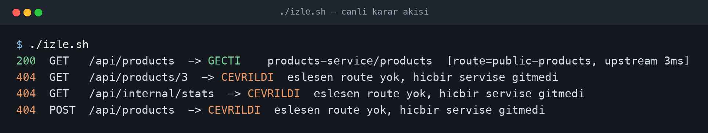

### Yöntem 2: İki tarafın loglarını saymak

Daha da ikna edici olan yöntem: aynı anda iki servisin logunu izleyip istek sayılarını karşılaştırmak.

```bash
docker compose logs -f kong products-api
```

Beş istek atın — biri izinli, dördü engelli — ve sayıları karşılaştırın:

```bash
docker compose logs kong --tail 200 | grep -cE '"(GET|POST) /api'   # -> 5
docker compose logs products-api | grep -c 'Request starting'       # -> 1
```

Kong beş istek gördü, .NET servisi bir. Aradaki dört istek servise hiç varmadı — ASP.NET Core'un `Request starting` satırı bile oluşmadı. Bu, "servis isteği gördü ama 404 döndü" senaryosunu tamamen eler.

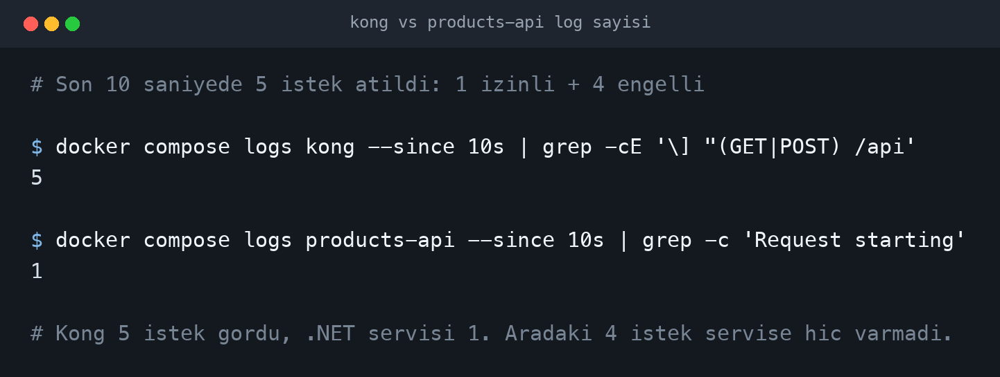

### Yöntem 3: Yanıt header'ları

En hızlı ipucu ise tek bir header'da:

```bash
curl -i localhost:8000/api/products        # izinli
curl -i localhost:8000/api/internal/stats  # engelli
```

| Header | İzinli | Engellenen |
|---|---|---|
| `Server` | **`Kestrel`** (.NET cevapladı) | **`kong/3.9.4`** (Kong cevapladı) |
| `X-Kong-Upstream-Latency` | var | **yok** |

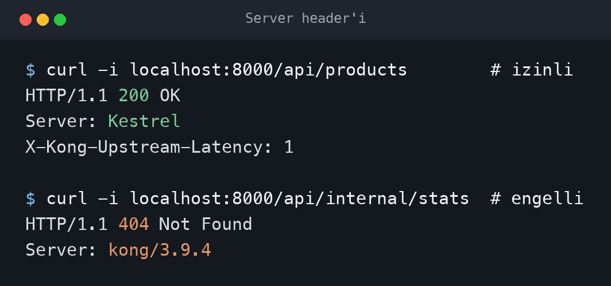

`Server: Kestrel` görüyorsanız istek arkaya gitti. `Server: kong/...` görüyorsanız kapıda çevrildi. `X-Kong-Upstream-Latency` header'ının yokluğu da aynı şeyi söylüyor: ölçülecek upstream süresi olmamış.

Bir 404 ile karşılaştığınızda "bu benim servisimin 404'ü mü, gateway'in 404'ü mü?" sorusunu bu header saniyeler içinde cevaplar. Hata ayıklarken en çok işinize yarayacak bilgi muhtemelen bu olacak.

---

## 8. Konfigürasyon Nerede Yaşıyor?

Burada durup şunu netleştirmek gerekiyor, çünkü alışkanlıklarımıza ters: `/api/products`'ın açık olduğu bilgisi **.NET kodunda değil**.

`products-api` hangi endpoint'inin dışa açık olduğunu bilmiyor. `docker-compose.yml`'de de değil. Ayar Kong'un **Postgres veritabanında** (`routes` ve `services` tabloları) duruyor; oraya Admin API üzerinden `curl` ile yazdık.

Aynı veriye bakan üç arayüz var:

| Yer | Nasıl |
|---|---|
| Admin API | `curl localhost:8001/routes/public-products` |
| Kong Manager | http://localhost:8002 → Routes → public-products → Edit |
| Veritabanı | DBeaver (localhost:5433) → `routes` tablosu (sadece OKU) |

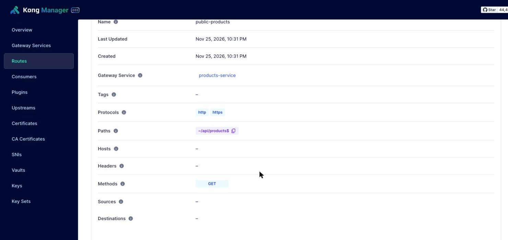

Açık endpoint'i belirleyen sadece iki alan:

```
paths   = ~/api/products$    <- hangi path (regex, $ = tam eşleşme)
methods = GET                <- hangi method
```

Bunları değiştirirseniz dışarıya açık olan endpoint değişir. Deploy yok, build yok:

```bash
# Sadece path'i değiştir
curl -X PATCH localhost:8001/routes/public-products \
  --data 'paths[]=~/api/v2/urunler$'

# Method ekle
curl -X PATCH localhost:8001/routes/public-products \
  --data 'methods[]=GET' --data 'methods[]=HEAD'
```

> Değişiklik birkaç saniye içinde yayılır (`db_update_frequency`, varsayılan 5 sn). Hemen test ederseniz eski davranışı görebilirsiniz — panik yapmadan bir kez daha deneyin.

Bu esneklik iki tarafı keskin bir bıçak. Bir endpoint'i saniyeler içinde kapatabilmek güzel; ama kimsenin code review'undan geçmeden saniyeler içinde **açılabilmesi** de aynı derecede mümkün. 10. bölümde buna döneceğiz.

---

## 9. Postgres'e Bakmak — ve Oraya Yazmamak

Konfigürasyon Postgres'te olduğuna göre, oraya doğrudan bakmak öğretici. Compose'da DB'yi 5433'ten host'a açmıştık (host'ta zaten 5432'de başka bir Postgres olduğu için).

DBeaver bağlantı bilgileri:

| Alan | Değer |
|---|---|
| Driver | PostgreSQL |
| Host | `localhost` |
| Port | **5433** |
| Database | `kong` |
| Username | `kong` |
| Password | `kongpass` |

Terminalden de bakabilirsiniz:

```bash
docker compose exec kong-db psql -U kong -d kong
```

İlginç tablolar:

| Tablo | İçerik |
|---|---|
| `services` | upstream tanımları |
| `routes` | eşleşme kuralları (`paths`, `methods`, `hosts`) |
| `plugins` | hangi plugin nerede açık, `config` kolonu JSONB |
| `consumers` | API tüketicileri |
| `keyauth_credentials` | API anahtarları (**düz metin**, hash'li değil) |
| `ratelimiting_metrics` | rate limit sayaçları (policy=cluster/redis ise dolar) |
| `targets` / `upstreams` | load balancer havuzları |

Route'ları ve bağlı oldukları servisleri tek sorguda görmek için:

```sql
select r.name as route, r.paths, r.methods,
       s.name as service, s.host, s.path
from routes r
join services s on r.service_id = s.id;
```

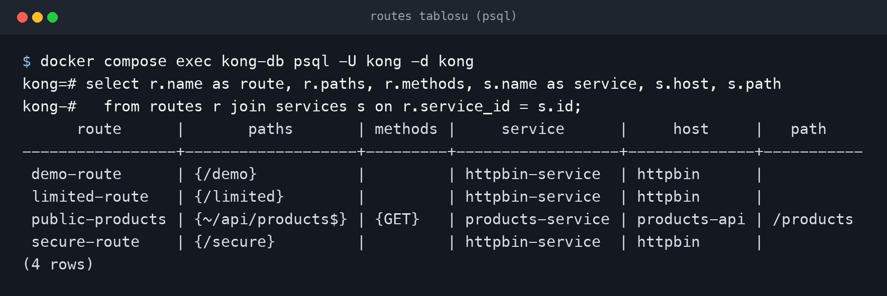

`keyauth_credentials` tablosundaki satıra bakmanızı özellikle öneririm: `gizli-anahtar-123` orada **düz metin** olarak duruyor. API anahtarları Kong'da hash'lenmez, çünkü gelen isteği karşılaştırabilmek için anahtarın kendisine ihtiyaç var. Bu, DB erişiminin kendisinin de bir sır olduğu anlamına gelir.

### UYARI: buraya yazmayın

Kong konfigürasyonu **node başlarken belleğe yüklenir** ve DB değişiklikleri otomatik yayılmaz. SQL ile `insert`/`update` yaparsanız Kong bunu görmeyebilir veya tutarsız bir duruma düşer (örneğin plugin'in `config` JSONB'sini şema doğrulamasından geçirmeden yazdınız).

Kural basit: **okumak için serbest, değiştirmek için Admin API (8001) veya Kong Manager (8002).**

---

## 10. Konfigürasyon Hiçbir Dosyada Yok: decK ile Declarative Config

Şimdi bu kurulumun en rahatsız edici tarafına gelelim.

`docker compose down -v` derseniz volume ile birlikte **tüm route / service / plugin / consumer tanımları silinir** ve hepsini baştan `curl`'lemeniz gerekir. Üstelik:

- Konfigürasyon git'te değil.
- Code review'dan geçmiyor.
- İki ortam arasındaki farkı göremiyorsunuz.
- "Bu route'u kim, ne zaman, neden ekledi?" sorusunun cevabı yok.

Yani altyapınızın güvenlik sınırını belirleyen ayar, versiyonlanmayan bir yerde yaşıyor. Kabul edilebilir bir durum değil.

Çözüm Kong'un resmî CLI'ı **decK**. Konfigürasyonu YAML'a döküyor ve geri yükleyebiliyor:

```bash
D="docker run --rm --network kong-test_default -v $PWD:/work -w /work kong/deck:latest"

# Mevcut konfigi dosyaya dök
$D gateway dump --kong-addr http://kong:8001 -o kong.yaml

# Dosya ile Kong arasındaki farkı gör (uygulamadan ÖNCE)
$D gateway diff --kong-addr http://kong:8001 kong.yaml

# Dosyayı uygula (Kong'u dosyadaki hale getirir)
$D gateway sync --kong-addr http://kong:8001 kong.yaml
```

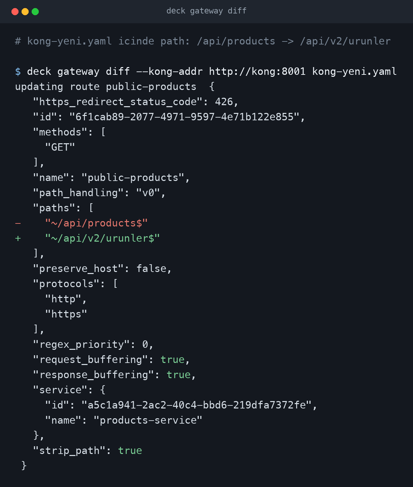

Çıkan `kong.yaml` artık okunabilir, versiyonlanabilir bir dosya:

```yaml
_format_version: "3.0"
services:
- name: products-service
  host: products-api
  port: 8080
  path: /products
  protocol: http
  routes:
  - name: public-products
    paths:
    - ~/api/products$
    methods:
    - GET
    strip_path: true
```

Buradaki kazanç sadece yedek almak değil. `deck gateway diff` komutu bir **pull request'te** çalıştırılabilir: "bu değişiklik `/api/internal/stats`'ı dışarıya açıyor" bilgisini merge'den önce görebilirsiniz. Gateway konfigürasyonu, kod kadar gözden geçirilmeye değer bir şey — çünkü hangi verinin dışarı çıktığına karar veren o.

Sıfırdan kurulumda artık iki komut yeterli:

```bash
docker compose up -d
$D gateway sync --kong-addr http://kong:8001 kong.yaml
```

**Dikkat:** `dump` çıktısı consumer'ları ve anahtarlarını da içeriyor — yani `kong.yaml` içinde `gizli-anahtar-123` düz metin olarak duruyor. Gerçek projede API anahtarları bu dosyaya girmemeli; decK'in `--skip-consumers` flag'i veya env var / vault referansları kullanılır. Yoksa git geçmişinize kalıcı olarak bir sır yazmış olursunuz.

---

## 11. Public Endpoint'i Sağlamlaştırmak

Bir endpoint'i dışarı açtıysanız iş bitmedi; artık internetin tamamı onu çağırabilir. Üç plugin'le hızlıca sağlamlaştıralım:

```bash
# Public olan her şey limitlenmeli
curl -X POST localhost:8001/routes/public-products/plugins \
  --data name=rate-limiting \
  --data config.minute=60 \
  --data config.policy=local

# Tarayıcıdan çağrılacaksa CORS
curl -X POST localhost:8001/routes/public-products/plugins --data name=cors

# Aynı liste tekrar tekrar üretilmesin
curl -X POST localhost:8001/routes/public-products/plugins \
  --data name=proxy-cache \
  --data config.strategy=memory \
  --data 'config.content_type=application/json'
```

Üçünün ortak noktası: hiçbiri .NET kodunu değiştirmiyor. `proxy-cache` özellikle öğretici — ikinci isteğe Kong'un belleğinden cevap verilir, `products-api` o isteği hiç görmez. Yanıttaki `X-Cache-Status: Hit` header'ı bunu doğrular.

Kurulabilen tüm plugin'lerin listesini merak ederseniz:

```bash
curl -s localhost:8001/ | jq -r '.plugins.available_on_server | keys[]'
```

Son olarak gözlemlenebilirlik için global bir Prometheus plugin'i:

```bash
curl -X POST localhost:8001/plugins --data name=prometheus
```

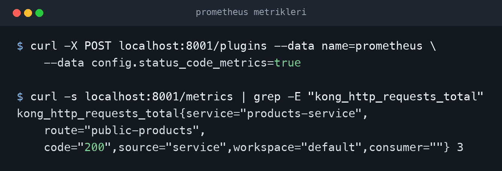

Artık `localhost:8001/metrics` adresinde route bazında istek sayıları, status kodu dağılımı ve gecikme histogramları var — her servise ayrı ayrı metrik kodu yazmadan.

---

## 12. Üretim İçin Dikkat Edilmesi Gerekenler

Bu kurulum lokal deneme için tasarlandı. Üretime taşımadan önce en az şu dört maddeye bakmak gerekiyor:

**1) Admin API asla public olmaz.** Bizim kurulumda 8001 kimlik doğrulamasız ve host'a açık — yani o porta erişen herkes istediği route'u açabilir, istediği plugin'i kaldırabilir. Üretimde Admin API ya sadece `127.0.0.1`'e bind edilir, ya ayrı bir ağda tutulur, ya da RBAC'li Kong Enterprise kullanılır.

**2) API anahtarları düz metin.** Hem DB'de hem `kong.yaml`'da. `key-auth` hızlı prototip için iyi; gerçek senaryoda JWT veya OAuth2 plugin'leri daha uygun olur.

**3) DB-less modunu değerlendirin.** Kong'u `declarative_config` ile Postgres olmadan da çalıştırabilirsiniz; konfigürasyon doğrudan `kong.yaml`'dan okunur. Böylece "konfigürasyon git'te değil" problemi kökten çözülür ve çalışma zamanında kimse Admin API'den değişiklik yapamaz. Bedeli: consumer/credential yönetimini runtime'da yapamamanız.

**4) `rate-limiting` politikası.** `local` politikası node başına sayar. Birden fazla node'a çıkacaksanız `redis` veya `cluster` politikasına geçin, yoksa koyduğunuzu sandığınız limit node sayısıyla çarpılır.

---

## 13. Sonuç ve İleri Adımlar

Bu yazıda:

- API Gateway'in neden her servise tek tek yazdığımız ortak işleri topladığını,
- Kong'un dört temel kavramını (Service / Route / Plugin / Consumer) ve "route eşleşmezse zincir biter" kuralını,
- Docker ile Kong Gateway OSS + Postgres kurulumunu,
- `rate-limiting`, `key-auth`, `cors`, `proxy-cache`, `file-log`, `prometheus` plugin'lerini kod değiştirmeden eklemeyi,
- Host'a hiç port açmayan iki .NET servisinin tek bir endpoint'ini `~/api/products$` regex'i ve `methods=GET` ile dışarıya açmayı,
- Engellenen isteklerin servise hiç ulaşmadığını üç ayrı yöntemle kanıtlamayı,
- Konfigürasyonun Postgres'te yaşadığını, oraya neden yazmamak gerektiğini ve decK ile git'e nasıl taşındığını

gördük. Kazancı tek cümlede toplamak gerekirse: `products-api`'nin kodunda hangi endpoint'inin dışarı açık olduğuna dair tek satır yok — o karar artık versiyonlanabilir bir konfigürasyon dosyasında yaşıyor.

Buradan ilerleyebileceğiniz konular:

- **Upstream & health check:** Birden fazla `products-api` replikası tanımlayıp Kong'un ölen node'u devre dışı bırakmasını izlemek.
- **JWT / OAuth2 plugin'leri:** `key-auth` yerine gerçek bir kimlik sağlayıcıyla entegrasyon.
- **request-transformer:** Backend'in beklediği header'ları kapıda eklemek, istemciden gelen tehlikeli header'ları silmek.
- **DB-less + CI/CD:** `kong.yaml`'ı git'te tutup pipeline'da `deck gateway diff` ile gözden geçirip `sync` ile uygulamak.
- **Kong Ingress Controller:** Aynı mantığı Kubernetes'te CRD'lerle yönetmek.
- **OpenTelemetry:** Gateway'den başlayan trace'i .NET servislerine kadar uçtan uca takip etmek.

### Proje yapısı

```
kong-test/
├─ makale.md                  # bu yazı
├─ NOTLAR.md                  # deneme notları + komut cheatsheet
├─ docker-compose.yml         # Kong + Postgres + migrations + httpbin + .NET servisleri
├─ kong.yaml                  # decK dump'ı (declarative config)
├─ izle.sh                    # Kong'un karar akışını canlı gösteren script
└─ services/
   ├─ products-api/           # .NET 9 minimal API (1 public, 3 internal endpoint)
   │  ├─ Program.cs
   │  └─ Dockerfile
   └─ orders-api/             # .NET 9 minimal API (tamamı internal)
      ├─ Program.cs
      └─ Dockerfile
```

### Github Reposu

https://github.com/emreozgoz/kong-makale

Herhangi bir eksik, yanlış vb. durumlar hakkında düzeltme yapmak için

"Linkedin" üzerinden benimle iletişime geçebilirsiniz.

Diğer yazılarda görüşmek üzere, hoşçakalın :)
